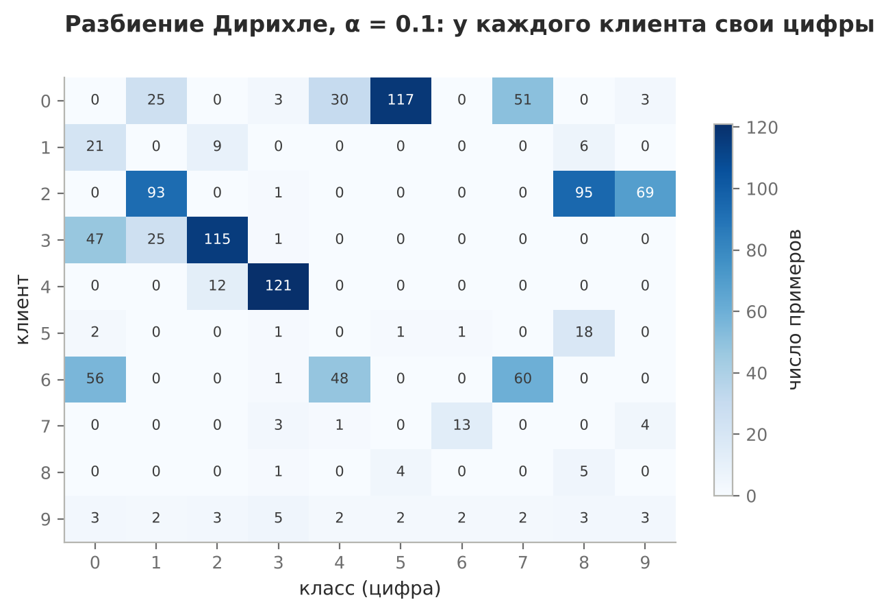
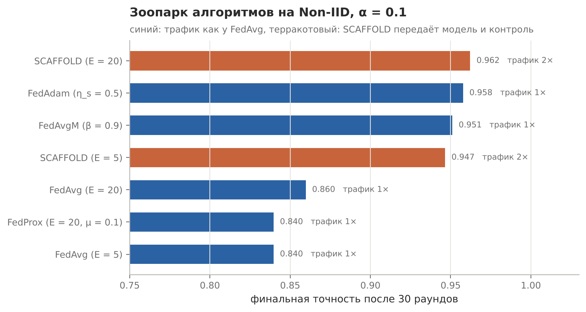
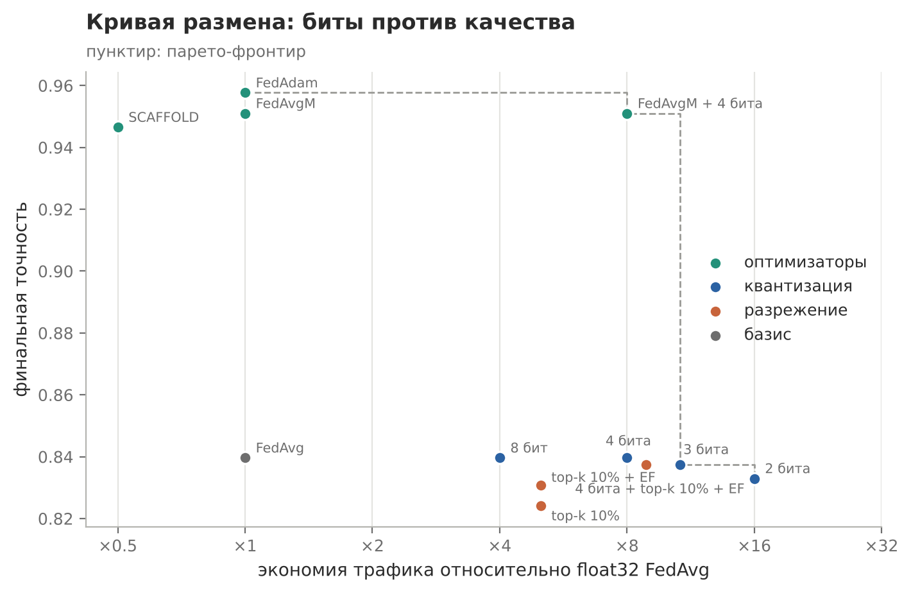

# Лабораторные по федеративному машинному обучению

9 работ по дисциплине «Федеративное машинное обучение: средство защиты персональных данных», 4 курс (2026): семь практических и две самостоятельные. Всё написано с нуля на numpy, без фреймворков вроде Flower: FedAvg, FedProx, FedAvgM, FedAdam, SCAFFOLD, квантизация и разрежение обновлений, атака по членству, вредители и устойчивая агрегация

У каждой работы своя папка со скриптом, графиками, таблицами замеров и README с условием и выводами

<table>
<tr>
<td><a href="lab_noniid_fedprox"></a></td>
<td><a href="lab_server_optimizers"></a></td>
<td><a href="lab_update_compression"></a></td>
</tr>
<tr>
<td align="center">Разбиение Дирихле по клиентам</td>
<td align="center">Зоопарк алгоритмов</td>
<td align="center">Трафик против качества</td>
</tr>
</table>

## Все работы

| Папка | Тема | Тип |
|---|---|---|
| [lab_central_vs_fedavg](./lab_central_vs_fedavg) | Централизованное обучение против FedAvg на синтетических non-IID клиентах | ПР №1 |
| [lab_fedavg_round_by_hand](./lab_fedavg_round_by_hand) | Один раунд FedAvg вручную: веса клиентов и агрегация | ПР №2 |
| [lab_noniid_fedprox](./lab_noniid_fedprox) | Non-IID через Дирихле, выпадение клиентов, свип μ у FedProx, ручной раунд FedProx | ПР №3 |
| [lab_privacy_security](./lab_privacy_security) | Атака по членству, обрезка и шум, вредители и медиана против среднего | ПР №4 |
| [lab_convergence](./lab_convergence) | Скорость сходимости в раундах, свип локальных эпох, тождество E = 1 | ПР №5 |
| [lab_server_optimizers](./lab_server_optimizers) | FedAvgM, FedAdam и SCAFFOLD на той же задаче | ПР №5 |
| [lab_update_compression](./lab_update_compression) | Стохастическая квантизация, top-k, error feedback, кривая размена | ПР №6 |
| [lab_clinics_case](./lab_clinics_case) | Кейс: стоит ли консорциуму клиник запускать FL | СР №1 |
| [lab_convergence_by_hand](./lab_convergence_by_hand) | Глобальный градиент, разброс ζ² и стационарная точка вручную | СР №2 |

Работы с третьей по шестую идут на одной задаче (digits из scikit-learn, 10 клиентов, softmax-регрессия, seed 42) и общем коде из папки [fl](./fl), поэтому их числа можно сравнивать между собой. Все эталонные значения из методичек курса воспроизводятся до четвёртого знака

Самое интересное нашлось по пути. Разбиение Дирихле в методичке теряет долю последнего клиента: при α = 0.1 до клиентов не доходит 19% обучающей выборки и почти весь класс 6. Курс показывает падение точности FedAvg на неоднородных данных на 12 п.п., а после исправления остаётся около 2.5 п.п. Получается, что бо́льшую часть «цены неоднородности» в эталонах даёт потеря данных, а не дрейф клиентов. Подробно в [lab_noniid_fedprox](./lab_noniid_fedprox). Там же и в [lab_privacy_security](./lab_privacy_security) ещё две находки: FedProx разваливается при lr·μ = 1, а тестовая выборка в практике по приватности целиком лежит в обучающих данных клиентов

## Запуск

```bash
pip install -r requirements.txt
python lab_noniid_fedprox/noniid_fedprox.py
```

Скрипты запускаются из корня сборника, каждый пересчитывает свои таблицы в `results/` и графики в `images/`. Самый долгий прогон (приватность) идёт около минуты

Стек: Python, numpy, pandas, scikit-learn, matplotlib
