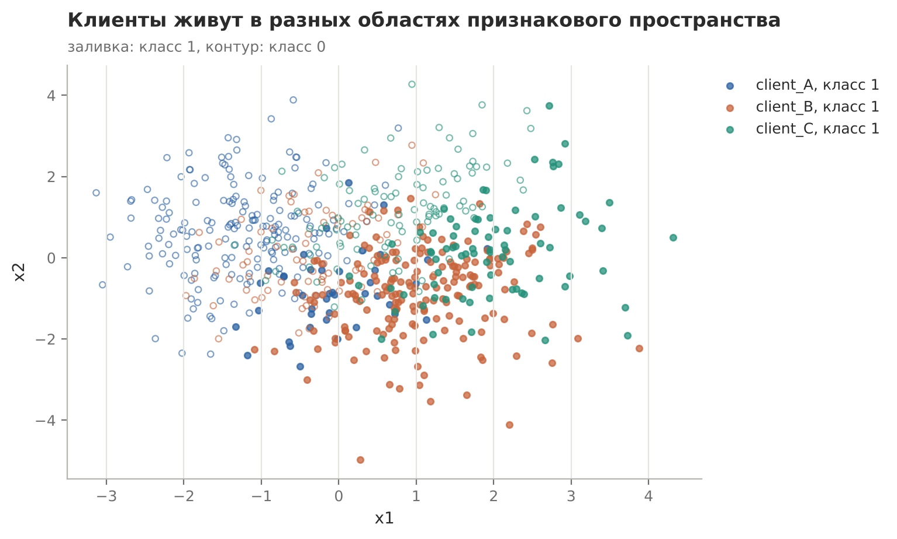
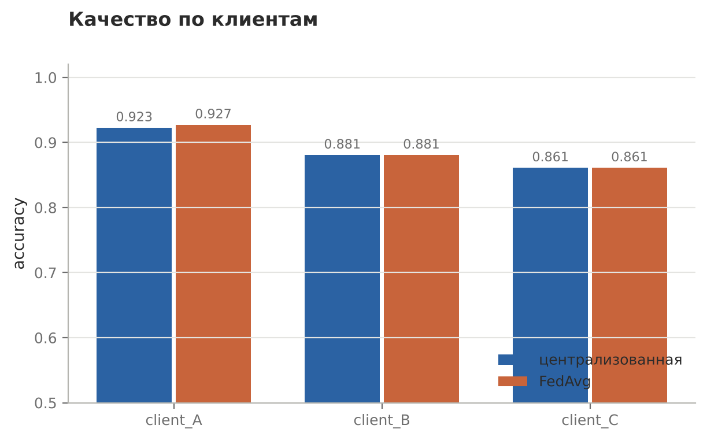

# Централизованное обучение против FedAvg

Практическая работа №1 по дисциплине «Федеративное машинное обучение»

## Задача

Три клиента с разными данными решают одну задачу бинарной классификации. Нужно сравнить логистическую регрессию, обученную на объединённой выборке, с FedAvg, где данные остаются у клиентов. Сравнение по общей точности, по каждому клиенту и по цене связи, плюс эксперимент с числом раундов и локальных эпох

## Решение

Данные синтетические, генерация повторяет скрипт курса с тем же seed, поэтому базовые числа совпадают с ним до четвёртого знака. Клиенты различаются в трёх местах сразу: сдвигом признаков, долей класса 1 (от 19% до 70%) и порогом разметки



Централизованная модель учится 200 эпох полным градиентом, FedAvg делает раунды по E локальных эпох с весами n_k/N. Трафик оценивается грубо: клиенты × параметры × 2 направления × раунды

## Результат

| | Шагов на клиенте | log loss | accuracy | Трафик, скаляров |
|---|---|---|---|---|
| Централизованная | 200 | 0.2759 | 0.8894 | 0 |
| FedAvg, 30 раундов, E = 5 | 150 | 0.2855 | 0.8909 | 540 |
| FedAvg, 50 раундов, E = 3 | 150 | 0.2854 | 0.8909 | 900 |
| FedAvg, 20 раундов, E = 8 | 160 | 0.2835 | 0.8879 | 360 |

На выпуклой задаче FedAvg догоняет централизованную модель, разница меньше 0.01. Разброс между клиентами (0.86–0.93) заметно больше, чем между подходами, и хуже всего обеим моделям на клиенте C с самым высоким порогом разметки. Одна общая accuracy этого не показывает



При одинаковом числе локальных шагов качество почти не меняется, а трафик отличается в 1.7 раза. Перенос работы на клиента (E = 8) экономит треть раундов ценой двух неверных ответов на 660 примеров

## Запуск

```bash
python lab_central_vs_fedavg/central_vs_fedavg.py
```
