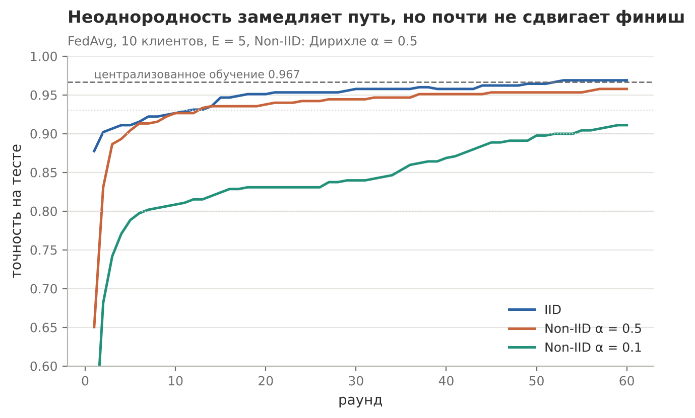
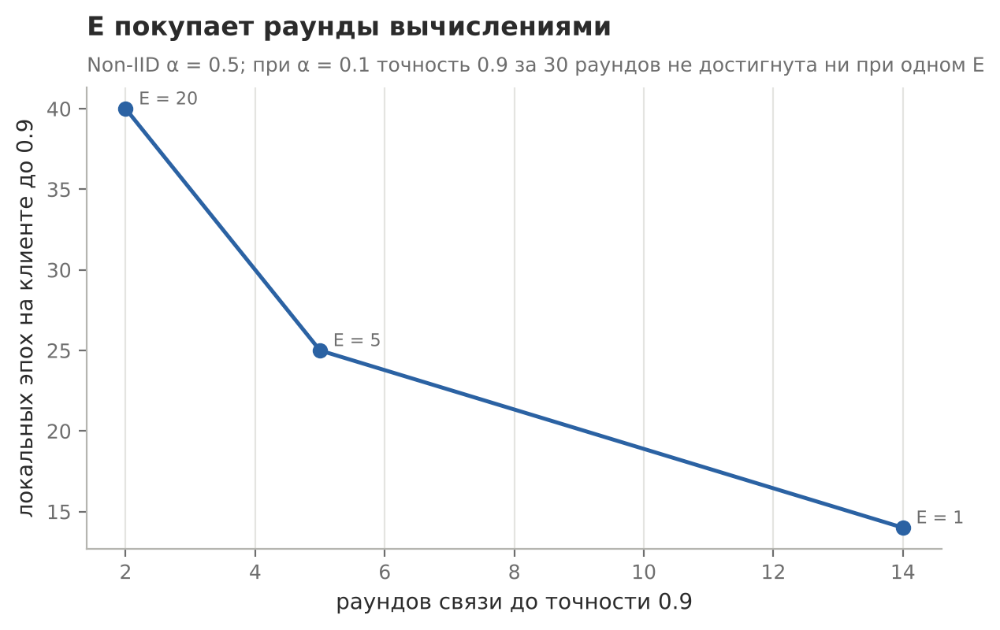

# Сходимость FedAvg в эксперименте

Практическая работа №5 по дисциплине «Федеративное машинное обучение»

## Задача

Проверить на практике выводы лекции о сходимости. Во сколько раз неоднородность увеличивает число раундов до целевой точности. Как на это влияет число локальных эпох E. Совпадает ли раунд FedAvg при E = 1 с шагом обычного градиентного спуска. Помогает ли FedProx на выпуклой задаче

## Решение

Та же задача, что в остальных работах (digits, 10 клиентов, softmax-регрессия), для Non-IID взято α = 0.5 и для сравнения α = 0.1. Скорость считается как номер раунда, на котором точность впервые достигает 0.8, 0.9 и 0.93. Тождество при E = 1 проверяется численно

## Результат



| | IID | Non-IID α = 0.5 | Non-IID α = 0.1 |
|---|---|---|---|
| Раундов до 0.90 | 2 | 5 | 55 |
| Раундов до 0.93 | 12 | 13 | не достигнута |
| Финал за 60 раундов | 0.969 | 0.958 | 0.911 |

Централизованная модель даёт 0.967. При умеренном перекосе неоднородность берёт цену временем, а не качеством, при сильном начинает брать и тем, и другим

Один раунд FedAvg при E = 1 отличается от шага GD на объединённых данных клиентов на 9.7·10⁻¹⁷, это точность машинной арифметики



Больше локальных эпох означает меньше раундов: до 0.9 при E = 1 нужно 14 раундов, при E = 20 нужно 2. Но в пересчёте на вычисления выходит наоборот, 14 эпох против 40 на клиенте. E покупает раунды вычислениями, а дрейф в выпуклой задаче слишком слабый, чтобы испортить эту сделку. FedProx с μ = 0.1 при E = 20 отстаёт от FedAvg (0.951 против 0.956), при μ = 1.0 и lr = 1.0 обучение разваливается

## Запуск

```bash
python lab_convergence/convergence.py
```
