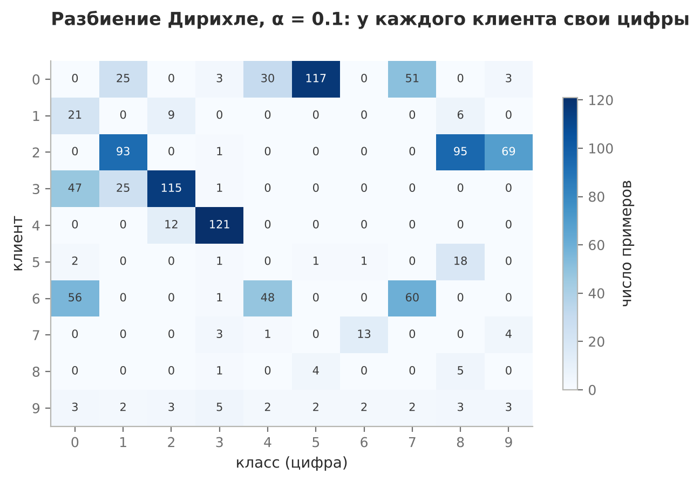
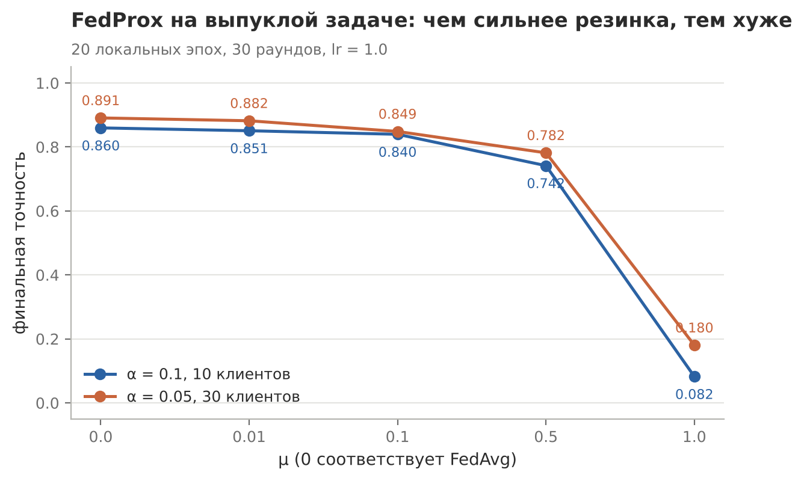
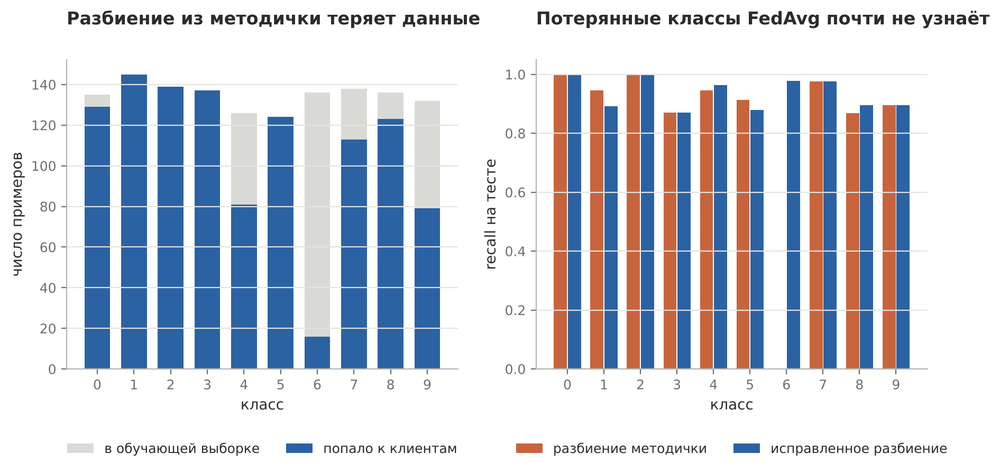

# Non-IID данные, выпадение клиентов и FedProx

Практическая работа №3 по дисциплине «Федеративное машинное обучение», с ручным раундом FedProx (3.1)

## Задача

Разбить digits между 10 клиентами по Дирихле с α = 0.1 и измерить, насколько FedAvg теряет в сравнении с IID-разбиением. Добавить выпадение клиентов, реализовать FedProx и проверить свипом μ, помогает ли он. Отдельно посчитать один раунд FedProx вручную

## Решение

Модель: softmax-регрессия 64 → 10, полный градиентный спуск, шаг 1.0, 30 раундов. FedProx добавляет к градиенту клиента одно слагаемое μ·(w − w_glob). Проверка корректности простая: при μ = 0 кривая совпадает с FedAvg во всех раундах. Выпадение прогоняется на пяти зернах, потому что одиночный запуск здесь ничего не доказывает



## Результат

| | Точность на 30-м раунде |
|---|---|
| FedAvg, IID | 0.9577 |
| FedAvg, Non-IID α = 0.1 | 0.8396 |
| Non-IID, выпадает 30% клиентов (5 зерён) | 0.80–0.86 |
| Non-IID, выпадает 50% клиентов (5 зерён) | 0.80–0.85 |

На неоднородных данных выпадение раскачивает обучение: финал зависит от того, кто попал в последний раунд. На IID те же 50% выпадения дают 0.953–0.958, потому что любые пять клиентов несут одну и ту же смесь классов



FedProx не помогает ни при одном μ: задача выпуклая, градиент полный, и резинка тормозит полезные шаги сильнее, чем вредный дрейф. При μ = 1.0 точность падает до 0.08 вместо 0.49 из эталона курса. Причина в произведении lr·μ = 1: локальный шаг превращается в прыжок от глобальной модели, и обучение начинает колебаться. С lr = 0.5 тот же μ даёт 0.82

### Разбиение из методички теряет данные

В коде курса строка `counts[-1] = len(order) - counts.sum()` вычитает сумму, в которую уже входит доля последнего клиента. Из 1348 обучающих примеров до клиентов доходят 1086, а от класса 6 остаётся 16 из 136



| Разбиение | Примеров у клиентов | FedAvg, E = 5 | FedAvg, E = 20 |
|---|---|---|---|
| Как в методичке | 1086 | 0.8396 | 0.8597 |
| Исправленное | 1348 | 0.9332 | 0.9443 |

Recall по классу 6 на исходном разбиении равен нулю, на исправленном 0.98. Так что из 12 п.п. разрыва IID и Non-IID примерно 9.5 даёт потерянный класс, а на сам дрейф клиентов остаётся около 2.5. В скрипте оба варианта переключаются параметром `keep_all`, основные таблицы посчитаны на исходном разбиении для сравнения с эталонами

### Раунд FedProx вручную

w₀ = 2.0, μ = 0.2, обновления клиентов укорачиваются в (1 − μ) раз. Получается w₁ = 2.16 против 2.20 у FedAvg, сдвиг за раунд меньше ровно на 20%

## Запуск

```bash
python lab_noniid_fedprox/noniid_fedprox.py
python lab_noniid_fedprox/fedprox_by_hand.py
```
