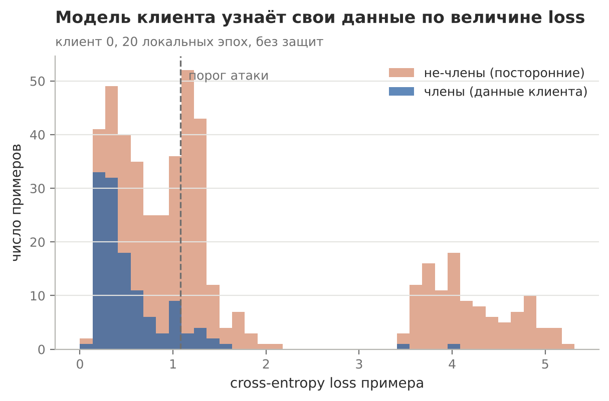
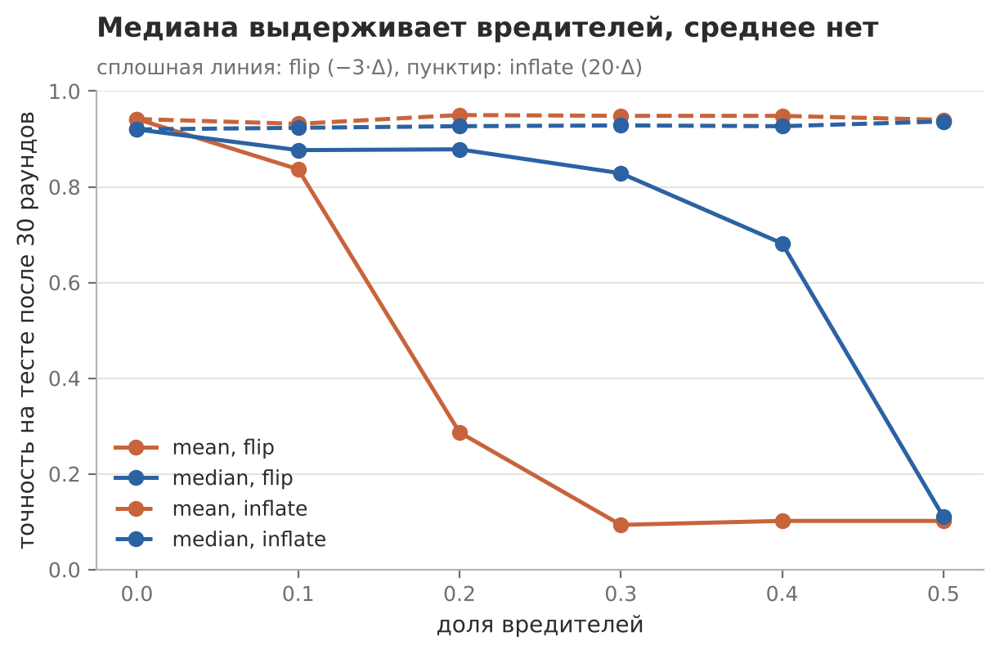

# Приватность и безопасность федеративного обучения

Практическая работа №4 по дисциплине «Федеративное машинное обучение»

## Задача

Проверить три вещи. Можно ли по модели клиента понять, был ли конкретный пример в его данных. Закрывают ли эту утечку обрезка градиентов и шум. Что происходит с FedAvg, если часть клиентов присылает испорченные обновления, и спасает ли медиана вместо среднего

## Решение

Digits разбит между 10 клиентами по Дирихле с α = 0.5. Атака по членству: на модели клиента считается loss для его примеров и для посторонних тех же классов, порог ставится посередине. Защита сделана как учебный DP-SGD: градиент каждого примера обрезается до нормы C, к среднему добавляется гауссов шум. Вредители бывают двух видов: flip присылает −3·Δ, inflate присылает 20·Δ

## Результат



Атака угадывает членство в 0.69–0.70 случаев против 0.50 у монетки, по всем десяти клиентам разброс 0.64–0.72. Обрезка до C = 0.3 роняет качество модели на своих данных с 0.91 до 0.58, а точность атаки остаётся около 0.70. Шум с σ до 3 тоже ничего не меняет: разрыв в loss между своими и чужими сохраняется. «Добавить шум» ещё не значит получить дифференциальную приватность, для неё нужен учёт бюджета ε



| Доля вредителей (flip) | 0 | 0.1 | 0.2 | 0.3 | 0.4 | 0.5 |
|---|---|---|---|---|---|---|
| mean | 0.942 | 0.837 | 0.287 | 0.093 | 0.102 | 0.102 |
| median | 0.920 | 0.877 | 0.878 | 0.828 | 0.682 | 0.110 |

Среднему хватает двух вредителей из десяти. Медиана держится, пока их меньше половины, и ломается ровно на 50%. Плата за устойчивость около 2 п.п., когда вредителей нет. Inflate не ломает ни одно правило: раздувание честного обновления только увеличивает шаг в правильную сторону

### Тест пересекается с обучением

В скрипте курса тест набирается из всего датасета после раздачи данных клиентам. В итоге все 600 тестовых примеров лежат в обучающих данных, а 39 «посторонних» для атаки на клиента 0 на самом деле его собственные. На честно отложенном тесте FedAvg даёт 0.922 вместо 0.942, а flip при 20% вредителей даёт 0.565 у среднего и 0.773 у медианы. Выводы не меняются, но абсолютные числа сдвигаются на 2–28 п.п.

## Запуск

```bash
python lab_privacy_security/privacy_security.py
```
