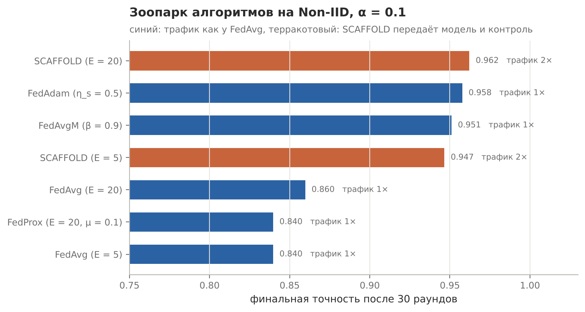
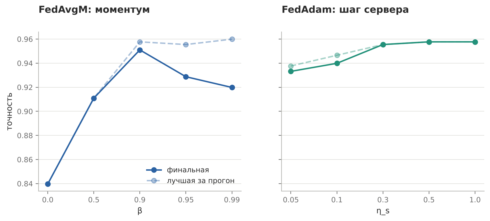

# Серверные оптимизаторы и SCAFFOLD

Практическая работа №5 по дисциплине «Федеративное машинное обучение» (вторая по номеру, по серверным оптимизаторам)

## Задача

Реализовать FedAvgM, FedAdam и SCAFFOLD поверх общего FedAvg и измерить их на Non-IID-задаче из работы с FedProx: что каждый алгоритм возвращает из потерянной точности и чего это стоит по трафику

## Решение

Сервер рассматривается как оптимизатор: обновление клиентов Δ уже направлено к их моделям, поэтому FedAvgM копит моментум и шагает вдоль него, FedAdam добавляет адаптивный шаг по координатам. SCAFFOLD живёт на клиентах: каждый хранит контроль c_k и на каждом шаге вычитает его из градиента, сервер усредняет контроли. Проверки: при β = 0 FedAvgM даёт ровно FedAvg, а со знаком минус в серверном шаге точность застывает на 0.10

## Результат



| Алгоритм | Трафик | Точность |
|---|---|---|
| FedAvg, E = 5 | 1× | 0.840 |
| FedProx, E = 20, μ = 0.1 | 1× | 0.840 |
| FedAvgM, β = 0.9 | 1× | 0.951 |
| FedAdam, η_s = 0.5 | 1× | 0.958 |
| SCAFFOLD, E = 5 | до 2× | 0.947 |
| SCAFFOLD, E = 20 | до 2× | 0.962 |

Серверный оптимизатор возвращает почти всю потерю без единого лишнего байта. Он же спасает при выпадении 30% клиентов: 0.951 у FedAvgM против 0.833 у FedAvg. SCAFFOLD при E = 20 обгоняет даже FedAvg на IID-данных (0.958), но платит двойным трафиком



При β = 0.99 пик за прогон самый высокий (0.960), но к 30-му раунду модель по инерции проскакивает и падает до 0.920. В жёстком режиме (α = 0.05, 30 клиентов) расстановка не меняется, SCAFFOLD с E = 20 снова первый с 0.964

На исправленном разбиении (без потери данных из методички, см. работу по FedProx) порядок алгоритмов тот же, но их выигрыш над FedAvg сжимается с 10–12 п.п. до 2–4. Похоже, на исходном разбиении серверные оптимизаторы частично лечат не дрейф, а дисбаланс классов

## Запуск

```bash
python lab_server_optimizers/server_optimizers.py
```
