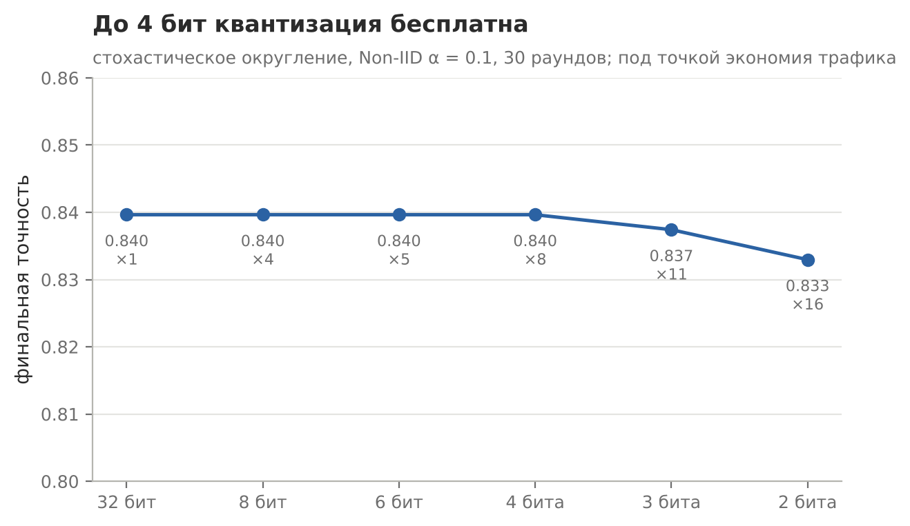
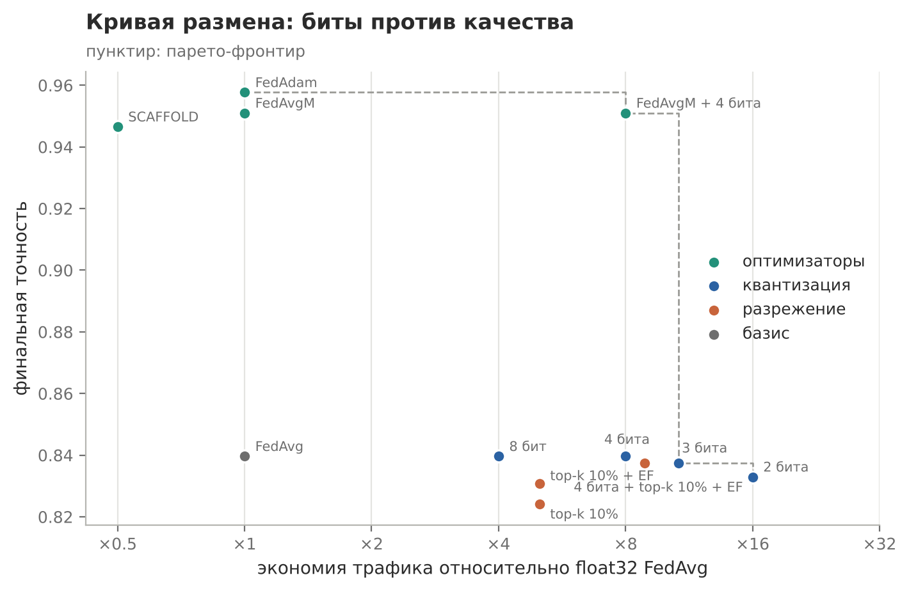

# Компрессия обновлений: квантизация и разрежение

Практическая работа №6 по дисциплине «Федеративное машинное обучение»

## Задача

Сжать обновления клиентов и посмотреть, сколько качества стоит каждый сэкономленный байт. Квантизация на b бит, top-k разрежение с честным учётом индексов, error feedback и их комбинации. Итог собрать в кривую размена вместе с алгоритмами из прошлых работ

## Решение

Модель имеет 650 параметров, без сжатия это 2600 байт на клиента за раунд. Квантизация стохастическая: значение округляется вверх с вероятностью дробной части, поэтому в среднем ошибки нет. Для одного бита сетка из методички вырождается в ноль, поэтому там передаётся только знак. В top-k каждая координата стоит значения и 32-битного индекса, error feedback копит выброшенный остаток и добавляет его к следующему обновлению

## Результат



| Схема | Байт за раунд | Экономия | Точность |
|---|---|---|---|
| float32 | 2600 | ×1 | 0.840 |
| 4 бита | 325 | ×8 | 0.840 |
| 2 бита | 163 | ×16 | 0.833 |
| 1 бит, знак | 81 | ×32 | 0.800 |
| top-k 10% без EF | 520 | ×5 | 0.824 |
| top-k 10% с EF | 520 | ×5 | 0.831 |
| 4 бита + top-k 10% + EF | 293 | ×8.9 | 0.837 |

До 4 бит квантизация бесплатна. Индексы съедают половину выигрыша от разрежения: 10% координат дают экономию ×5, а не ×10. Без error feedback выброшенная часть копится как систематическая ошибка, тот же механизм, что у дрейфа на неоднородных данных



Лучшую точку на кривой даёт не сжатие само по себе, а связка FedAvgM и 4-битной квантизации: ×8 экономии при точности 0.951, выше несжатого FedAvg. Серверный оптимизатор и сжатие работают на разных уровнях и не мешают друг другу

## Запуск

```bash
python lab_update_compression/update_compression.py
```
